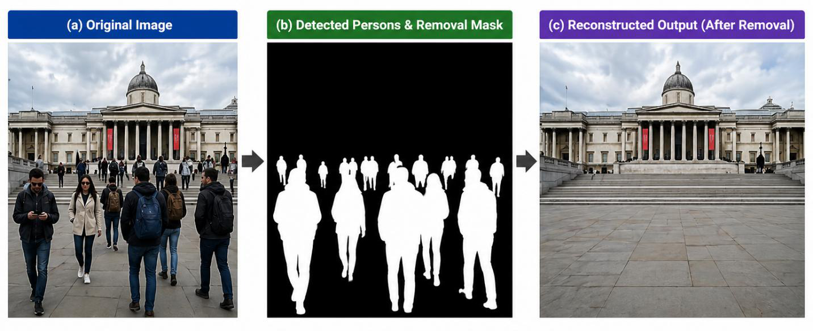
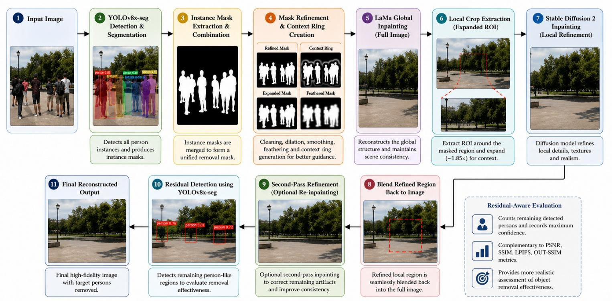
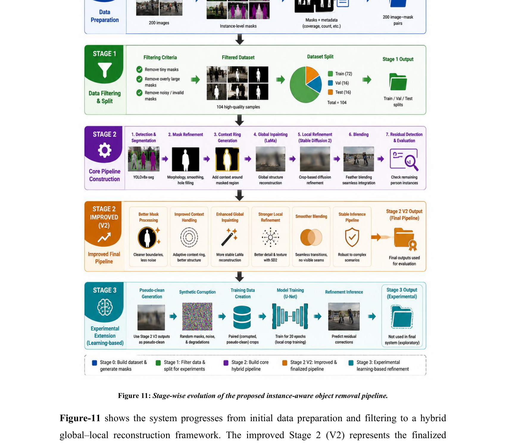

# Instance-Aware Object Removal and Background Reconstruction


> **Research title:** *Instance-Aware Object Removal and Background Reconstruction Using Hybrid Inpainting with Comprehensive Evaluation*

This repository contains the complete CSE 498R directed-research workflow for removing people from crowded real-world images and reconstructing the hidden background. The project combines instance detection and segmentation, mask refinement, global and local inpainting, residual-person detection, and quantitative evaluation in a staged experimental pipeline.

The final evaluated Stage 2 system uses refined person masks, **LaMa** for global reconstruction, and **Stable Diffusion 2** for difficult local regions. A later Stage 3 experiment adds a compact trainable U-Net as a post-refinement module; its results are reported transparently as a negative ablation rather than as a production improvement.

This work was developed for **CSE 498R: Directed Research (Spring 2026)** at North South University under the supervision of **Dr. Jilan Samiuddin**.







## Research Contributions

* Built an end-to-end, instance-aware pipeline for detecting, masking, and removing multiple people from complex scenes.
* Compared single-shot and progressive inpainting across 78 valid Week 4 samples using PSNR, SSIM, LPIPS, mask coverage, and runtime.
* Developed a hybrid Stage 2 pipeline combining global LaMa reconstruction with local diffusion refinement and residual-aware second-pass processing.
* Evaluated the final Stage 2 pipeline on 104 samples with region-aware and full-image metrics.
* Designed and trained a **1,928,771-parameter lightweight U-Net** for mask-conditioned local post-refinement.
* Preserved unsuccessful experimental directions, including the Stage 3 v1 over-smoothing failure mode, to keep the research record reproducible.

## Pipeline

| Stage | Purpose | Main techniques |
| --- | --- | --- |
| Stage 0 | Build the research subset and generate initial masks | COCO subset, person detection, mask generation |
| Stage 1 | Produce selective segmentation and initial inpainting | Instance masks, classical and pretrained inpainting |
| Stage 2 | Reconstruct difficult multi-person regions | LaMa global fill, Stable Diffusion local refinement, feathered blending, residual detection |
| Stage 3 v1 | Test learned local post-refinement | 4-channel U-Net, pseudo-clean targets, synthetic corruption, masked reconstruction loss |



## Verified Experimental Results

### Single-shot versus progressive inpainting

Week 4 evaluated 78 valid images. Method A merges all person masks and performs one inpainting pass; Method B removes people progressively, largest first.

| Metric | Single-shot | Progressive | Difference |
| --- | ---: | ---: | ---: |
| Mean PSNR | 13.7568 dB | **13.8858 dB** | +0.1290 dB |
| Mean SSIM | 0.5708 | **0.5780** | +0.0072 |
| Mean LPIPS ↓ | 0.4365 | **0.4113** | -0.0252 |
| Mean runtime | **0.196 s** | 1.084 s | 5.53× slower |

Progressive processing produced modest average quality gains, including a **5.8% reduction in LPIPS**, at a substantial runtime cost.

### Final Stage 2 evaluation

The final Stage 2 CSV contains 104 evaluated samples. These dataset means were computed from [`Final update cse498R/stage2_results_all_samples_104.csv`](Final%20update%20cse498R/stage2_results_all_samples_104.csv).

| Metric | Mean |
| --- | ---: |
| Region PSNR | 18.1696 dB |
| Region SSIM | 0.7134 |
| Full-image LPIPS ↓ | 0.000062 |
| Outside-mask SSIM | 0.7741 |
| Total processing time | 7.937 s/image |
| Residual person detections | 6.96/image |

These are **proxy evaluation metrics**, not clean-background ground-truth scores. Real COCO scenes do not provide the hidden background after a person is removed.

## Lightweight U-Net: Verified Evidence

The Stage 3 v1 notebook implements `UNetSmall`, a three-level encoder-decoder with skip connections, transposed-convolution upsampling, batch normalization, and a sigmoid RGB output.

| Property | Verified value |
| --- | ---: |
| Trainable parameters | **1,928,771** |
| Input | 4 channels: RGB + binary mask |
| Output | 3-channel refined RGB patch |
| Crop size | 256 × 256 |
| Pseudo-clean pool | 15 samples |
| Training/validation split | 12 / 3 samples |
| Training epochs | 20 |
| Training loss | 1.086120 → 0.465837 (**57.1% reduction**) |
| Validation loss | 0.961680 → 0.497957 (**48.2% reduction**) |
| Stage 3 inference | 16/16 samples, mean 0.0636 s/sample |

### Baseline comparison and interpretation

The model trained and converged, but it **did not improve the Stage 2 baseline**:

| Masked-region sharpness | Mean |
| --- | ---: |
| Stage 2 baseline | 90.5912 |
| Stage 3 U-Net | 29.4302 |
| Absolute change | -61.1610 |
| Relative change | **-67.5%** |

Stage 3 v1 behaved as a smoothing/denoising module. The small pseudo-supervised dataset, strong synthetic blur corruption, direct RGB reconstruction, and absence of residual learning encouraged conservative outputs. Consequently, **Stage 2 improved v2 remains the final selected pipeline**; Stage 3 v1 is retained as a documented ablation and a basis for a future residual-detail model.

Evidence notebook: [`WEEK-6/week-6 updates/stage3_V1(learning_based_local_refinement_model).ipynb`](WEEK-6/week-6%20updates/stage3_V1(learning_based_local_refinement_model).ipynb)


## Repository Structure

```text
CSE-498R-Directed-Research/
├── assets/                         # README architecture and result figures
├── figures/                        # Thesis figures and visual analyses
├── update1/                        # Early masking experiments
├── update2/                        # Batch removal experiments
├── update3/                        # Diffusion-inpainting baseline
├── Update4/                        # Single-shot vs progressive evaluation
├── update 5/                       # Expanded pipeline experiments
├── update6/                        # Final Stage 0–3 notebook snapshots
├── WEEK-6/                         # Final staged notebooks and analysis
├── Final update cse498R/           # Final Stage 2 results
├── CSE498R_Final_Thesis-.../       # Thesis dataset, masks, metadata, outputs
├── 498R Proposal Form.pdf
├── CSE498R BlackBook Final v2 main .pdf
└── Work plan.pdf
```

The repository intentionally preserves intermediate notebooks and research artifacts so that the evolution of the methodology and its negative results remain reproducible. The `stage2_improved_v2` notebook is the finalized pipeline used for evaluation.

---

## Getting Started

The notebooks run in **Google Colab** (GPU runtime recommended; T4 or A100).

1. Open [`WEEK-6/week-6 updates/cse498r_final_stage2_improved_v2.ipynb`](WEEK-6/week-6%20updates/cse498r_final_stage2_improved_v2.ipynb) in Google Colab.
2. Enable a GPU runtime: *Runtime → Change runtime type → GPU*.
3. Run the setup cell to install dependencies:
   ```bash
   pip install ultralytics simple-lama-inpainting diffusers transformers \
               lpips opencv-python-headless Pillow matplotlib pandas tqdm scikit-image
   ```
4. Upload a dataset ZIP of person images (MS COCO subset), or mount Google Drive.
5. Run the cells in order: dataset extraction → mask generation → refinement → LaMa → Stable Diffusion refinement → residual-aware evaluation. Metrics are written to CSV for analysis.

Several notebooks expect artifacts produced by the preceding stage. Large notebook artifacts are stored using Git LFS; run `git lfs install` before cloning if you need their full contents.

---

## Methods & Tools

| Component             | Tool / Model                    |
| --------------------- | ------------------------------- |
| Detection & segmentation | YOLOv8x-seg (Ultralytics)    |
| Global inpainting     | LaMa (`simple-lama-inpainting`) |
| Local refinement      | Stable Diffusion 2 (Diffusers)  |
| Experimental post-refinement | Lightweight PyTorch U-Net |
| Mask processing       | OpenCV (morphology, feathering) |
| Metrics               | PSNR, SSIM, OUT-SSIM, LPIPS + residual detection |
| Dataset               | MS COCO (multi-person subset)   |
| Environment           | Google Colab / Kaggle (PyTorch, CUDA GPU) |

---

## Limitations & Future Work

* No clean ground-truth backgrounds exist for real COCO scenes, so evaluation relies on proxy and residual-based metrics.
* Complete semantic removal in dense, heavily overlapping crowds remains unsolved (avg. ~6.96 residual detections).
* Diffusion refinement is computationally heavy (~7.9 s/image) and is not real-time.
* The Stage 3 v1 pseudo-supervised dataset is too small to establish generalization.
* The first U-Net post-refiner over-smoothed edited regions; future versions should predict residual high-frequency detail instead of reconstructing the complete RGB crop.
* **Future:** synthetic paired ground-truth data, detector-guided residual loops, larger controlled ablations, YOLO+SAM ensemble masks, and ControlNet-guided diffusion.

---

## Team & Academic Context

* **Course:** CSE 498R — Directed Research (Spring 2026)
* **Institution:** North South University, Department of Electrical and Computer Engineering
* **Supervisor:** Dr. Jilan Samiuddin (Assistant Professor, ECE)

| Team Member          | Student ID |
| -------------------- | ---------- |
| Md. Minhajul Islam   | 2211022042 |
| Azmain Iqtidar Arnob | 2211786042 |
| Aqib Ahmed           | 2211335042 |
| Atikul Islam Nahid   | 2211978042 |

---

## Citation

If you use this repository in academic work, cite it as a CSE 498R directed-research project and link to this repository. A formal publication citation is not currently available.
